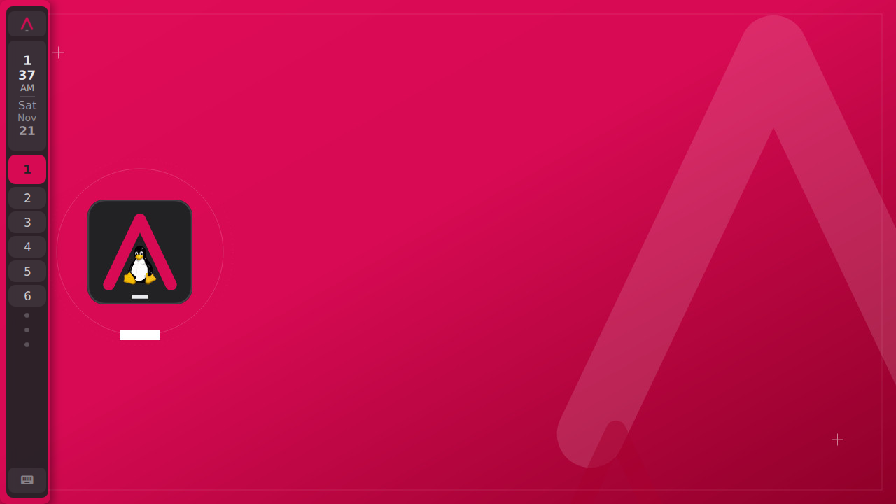
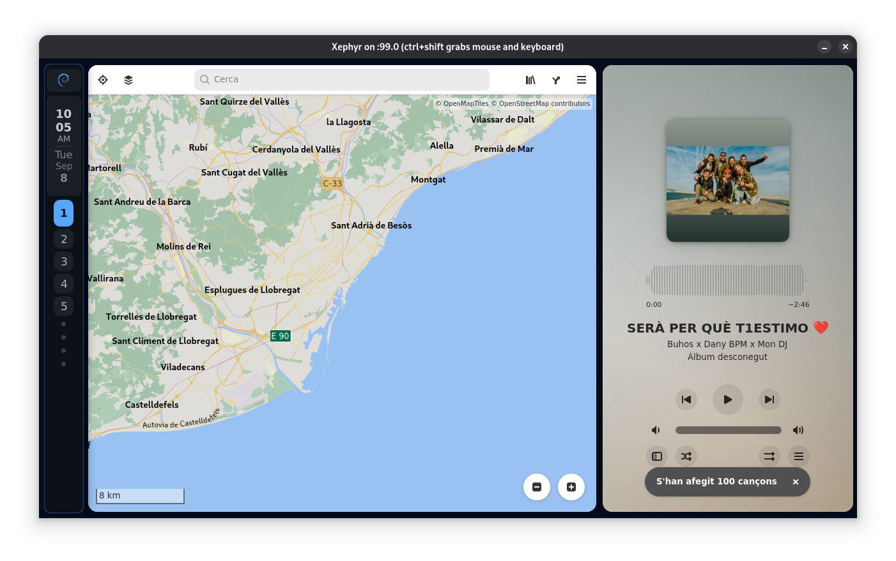
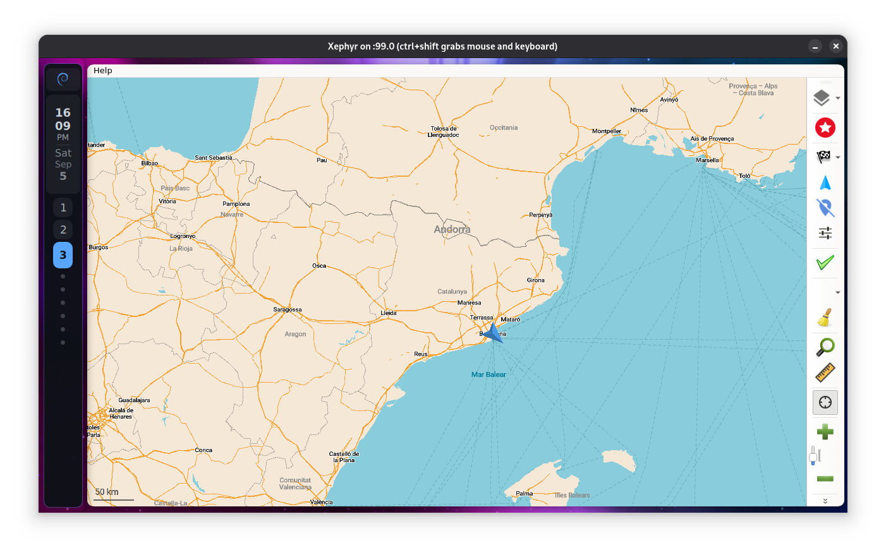

# aa-linux

**Project site:**
[aa-linux](https://mfont-bz17.github.io/aa-linux/) —
screenshots, architecture, build notes, and current status.

**Artwork:**
[aa-linux artwork](https://mfont-bz17.github.io/aa-linux/artwork/index.html) — logo, variants, lockups,
color themes, wallpapers, and downloads.

`aa-linux` is a Linux phone-side implementation of the Android Auto protocol.
It plays the role of the Android phone in an Android Auto session: it
authenticates with a head unit or Google's Desktop Head Unit (DHU) emulator
over TCP, FunctionFS USB, or Bluetooth/Wi-Fi, then streams the Linux desktop as
H.264 video together with optional AAC-LC audio, while relaying touch, key, and
vehicle sensor data in the other direction.

For the interface, the bundled `openbox-desktop` desktop environment — an
openbox + quickshell UI shell — gives the projected desktop a car-friendly
layout with a status bar, launcher, network applet, and sensor dashboard that
aa-linux captures and displays on the head unit.

This is an experimental, **AI-assisted / vibe-coded** project built to learn
and document the Android Auto protocol — not a production-grade implementation.
Code was generated iteratively with an AI coding assistant, reviewed manually,
and kept intentionally small and readable so you can follow the handshake,
framing, and media paths. Expect rough edges, incomplete features, and breaking
changes.

This is an independent interoperability project. It is not affiliated with or
endorsed by Google. Android Auto, Google Automotive Link, and related marks are
owned by their respective owners.

## Status

The current implementation supports:

- Android Auto protocol version negotiation, TLS, authentication, and service discovery
- H.264 video streaming from X11 or an FFmpeg test pattern
- TCP, FunctionFS USB gadget, and wireless Bluetooth/Wi-Fi transports
- Touch/input forwarding and pluggable vehicle sensor backends
- Vehicle sensor readings from the head unit published over D-Bus (`org.aalinux.sensors`)
- A mock wireless handshake and protocol self-tests
- A full desktop UI shell (`openbox-desktop`, openbox + quickshell) for the projected desktop

### Roadmap (not ordered)

- [ ] Improve ob-grid launcher
- [ ] Audio streaming from Pipewire
- [x] On screen keyboard
- [x] Desktop color theme
- [ ] Hide the cursor when needed
- [ ] Add NMEA service for GeoClue2
- [ ] Show car sensor in desktop
- [ ] RaspberryPi/OrangePi OTG USB gadget support
- [ ] Wayland support
- [ ] Others....

Hardware and head-unit compatibility varies. Treat this as experimental
research software and **do not use it while driving** or as a daily driver —
use it on a bench / parked setup to study the protocol.

## Quick Test With The Virtual Desktop

The fastest way to try aa-linux is the `desktop` command: it starts a virtual
Xvfb display on `:99` (1280x720x24), launches the workspace openbox window
manager on it, and runs the phone-side TCP transport capturing that display —
all in one command. You only need the Desktop Head Unit (see the Quick Start
section) to see the projected desktop:

```sh
# Terminal 1: virtual desktop (Xvfb + openbox) and the phone side over TCP
./aa-linux.sh desktop

# Terminal 2: run the DHU
./dhu.sh
```

Video capture currently supports X11 only through FFmpeg `x11grab`; Wayland
capture is not supported. Run an additional X11 application inside the virtual
desktop from another terminal:

```sh
DISPLAY=:99 firefox &
# Or: DISPLAY=:99 xterm &
```

Capture the virtual display to a PNG with:

```sh
./aa-linux.sh dev-screenshot
# writes screenshots/dev-<timestamp>.png

./aa-linux.sh dev-screenshot --display :99 screenshots/desktop.png
```

### openbox Desktop Environment

`openbox-desktop` is a full desktop environment for the aa-linux project: a
UI shell built on **openbox** (the window manager) and **quickshell** (a Qt
QML shell engine that provides the panels, launcher, status bar, network
applet, sensor dashboard, and other widgets). It runs on a virtual display and
gives the captured desktop a car-friendly interface. It is based on the
[justaguylinux openbox-setup](https://codeberg.org/justaguylinux/openbox-setup) project.
Its custom launcher is the `ob-grid` script, a YAML grid window launcher that
reads its layout from `config/app-grid.yaml`.

The desktop uses [**Onboard**](https://github.com/onboard-osk/onboard) as its on-screen keyboard. It auto-starts with the
session and appears at the bottom of the screen when text input is needed; the
bar's keyboard button (`Onboard.qml`) toggles its visibility over D-Bus
(`org.onboard.Onboard.Keyboard.ToggleVisible`), with a small `dbus-fast` helper
(`config/scripts/onboard-watch`) tracking the keyboard's real `Visible` state so
the icon reflects how the keyboard is shown or hidden, no matter the method.
Its color scheme is generated from the active desktop palette by
`config/scripts/onboard-theme`, which renders `onboard/themes/aa-linux.colors`
from `aa-linux.colors.template` and reloads Onboard in place.

Launch it with `openbox-desktop.sh`, which starts the environment on the `:99`
virtual display:

```sh
./openbox-desktop.sh
```

`aa-linux.sh desktop` starts the same environment headlessly on Xvfb and runs
the phone-side TCP transport capturing it.

Pass `--grid FILE` to either desktop command to use a different ob-grid
layout. The included `openbox-desktop/config/app-grid-maps-music.yaml` opens GNOME Maps and
Amberol side by side on workspace 1:

```sh
./aa-linux.sh dev-desktop --grid openbox-desktop/config/app-grid-maps-music.yaml
./aa-linux.sh desktop --grid openbox-desktop/config/app-grid-maps-music.yaml
```

When launching `openbox-desktop.sh` directly, set
`AA_APP_GRID=/path/to/grid.yaml` instead.

For a live Xephyr window instead of headless Xvfb, use `dev-desktop`. Pass
`--resolution WxH` to change the virtual screen size (default `1280x720`):

```sh
./aa-linux.sh dev-desktop --resolution 1920x1080
```





## Architecture

`aa-linux` acts as the phone side. The head unit initiates the Android Auto
session; `aa-linux` authenticates, sends the captured screen and audio, and
receives input and vehicle sensor messages.

In Android Auto terminology, `aa-linux` replaces the phone-side Gearhead
component. The Desktop Head Unit (DHU) and a car's built-in display are head
units; they are not included in this repository.

The X11 screen that gets captured can be any desktop, including the bundled
`aa-linux-openbox` environment, which runs on a virtual display (Xvfb for
headless use or Xephyr for development) so the whole UI is projectable to the
head unit.

```text
                         Android Auto session
       +------------------- protocol + TLS -------------------+
       |                                                       |
+------v-------+                                      +--------v--------+
|   aa-linux   |                                      |    Head unit    |
| phone side   |                                      | car display/DHU |
|              |                                      |                 |
| X11 capture  |---- H.264 video -------------------->| video renderer  |
| audio input  |---- AAC audio ---------------------->| audio sink      |
| input sink   |<--- touch / key events --------------| input controls  |
| sensor API   |<--- vehicle sensor messages ---------| sensor source   |
+--------------+                                      +-----------------+
```

The same protocol state machine is used with each transport:

```text
1. TCP                    2. USB FunctionFS             3. Wireless

+-----------+             +-----------+                 +-----------+
| aa-linux  |             | aa-linux  |                 | aa-linux  |
| TCP :5277 |<----------->| USB gadget|<--------------->| Bluetooth |
+-----+-----+             +-----+-----+                 +-----+-----+
      ^                         ^                             |
      |                         |                             | RFCOMM setup
      |                         |                             | Wi-Fi credentials
+-----+-----+             +-----+-----+                       v
| Head unit |             | Desktop   |                 +------------+
| or DHU    |             | Head Unit |                 | Car Wi-Fi  |
+-----------+             +-----------+                 | + Head unit|
                                                        +------------+
                                                               |
                                                               | TCP
                                                               +---------->
                                                                  aa-linux
```

For wireless mode, Bluetooth is used for pairing and Wi-Fi setup. After the
phone joins the head unit's access point, the normal Android Auto protocol runs
over TCP. USB mode requires a Linux FunctionFS gadget; TCP mode is the simplest
development path.

## Quick Start With The DHU

The Desktop Head Unit (DHU) is Google's development head-unit emulator. It is
not distributed with this project. Download **Android Auto Desktop Head Unit
Emulator** from the [official DHU documentation](https://developer.android.com/training/cars/testing/dhu)
using Android Studio's SDK Manager, or install it with:

```sh
sdkmanager "extras;google;auto"
chmod +x "$ANDROID_SDK_ROOT/extras/google/auto/desktop-head-unit"
```

The binary is normally installed in
`$ANDROID_SDK_ROOT/extras/google/auto/`. The `dhu.sh` wrapper also checks common
SDK locations and accepts `DHU=/path/to/desktop-head-unit`.

Install the Python dependency and run the local checks:

```sh
python3 -m venv .venv
. .venv/bin/activate
pip install -e .
./aa-linux.sh self-test
```

### TCP On One Machine

This is the recommended first integration test. Open two terminals in the
repository. The first runs the phone side and listens on TCP port `5277`; the
second runs the DHU and connects to it.

```sh
# Terminal 1
./aa-linux.sh tcp

# Terminal 2
./dhu.sh
```

The default video source is the FFmpeg color-bar test pattern, so no X server or
application is needed for this smoke test. Pass `--display` to capture another
display instead. The local development TLS identity and DHU test-time shim are
used automatically. They are only for the separately obtained local DHU and must
not be used with a real car.

### USB Dummy Test

After TCP works, USB can be tested on the same Linux machine if the kernel has
`libcomposite`, `usb_f_fs`, and `dummy_hcd`:

```sh
# Terminal 1
sudo ./aa-linux.sh gadget-start

# Terminal 2
./aa-linux.sh usb

# Terminal 3
./dhu.sh --usb
```

Stop the gadget when finished:

```sh
./aa-linux.sh gadget-stop
```

## Requirements

- Python 3.10 or newer
- FFmpeg with H.264 and AAC support
- A compatible head unit or the Desktop Head Unit obtained separately from the
  official Android Auto SDK
- `protobuf` Python package
- X11 and `x11grab` for real screen capture
- Xvfb/Xephyr and openbox for the optional virtual desktop display
- quickshell (`qs`) for the aa-linux-openbox UI shell

Screen capture currently supports **X11 only** through FFmpeg's `x11grab`
source. Wayland capture is not implemented. When a requested X11 capture
display is unavailable, aa-linux can auto-start Xephyr, provided a parent X11
server is already running. The `desktop` command instead uses Xvfb, which needs
no parent X11 server.

Optional USB and wireless transports require additional Linux tooling; see the
Quick Start and Other Transports sections.

Production phone-side TLS credentials are intentionally not included. The
expired development identity is only for local DHU testing; provide real-car
credentials with `--cert` and `--key`. See `aa-linux/certs/README.md`.

## Other Transports

For wireless mode, install BlueZ, `bluez-tools`, and NetworkManager. Discover the
head unit's Bluetooth MAC address with:

```sh
./aa-linux.sh scan-bt
```

Then run:

```sh
./aa-linux.sh wireless --bt-address AA:BB:CC:DD:EE:FF \
  --cert CERT --key KEY
```

Wireless setup can replace the machine's normal network connection. Do not use
verbose logs or packet captures containing credentials. Passphrases are redacted
from diagnostic output.

## Known Issues

## Android Auto Protobuf

The protobuf source definitions are in `aa-linux/protos/oaa/`. The generated
Python modules are in `aa-linux/generated/oaa/`. These definitions are based in
part on the open Android Auto protocol research and definitions from
[`mrmees/open-android-auto`](https://github.com/mrmees/open-android-auto), with
additional analysis and corrections documented in the individual source files.

The project does not redistribute Google's Desktop Head Unit, Android Auto APKs,
decompiled APK contents, or production authentication credentials. Obtain those
separately and comply with their applicable terms.

## License

The original project code and protocol definitions are released under the GNU
General Public License, version 3 or later. See `LICENSE` and
`THIRD_PARTY_NOTICES.md` for attribution and component details.
