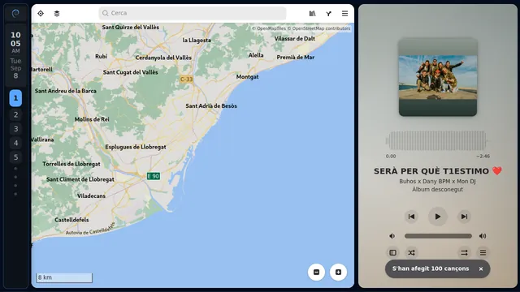

# aa-linux project page style guide

Use this guide when creating or extending the static project page in `docs/`.
The reference implementation is:

- `docs/index.html`
- `docs/assets/style.css`
- `docs/assets/site.js`
- `docs/artwork/assets/logo-icon.svg`
- `docs/assets/og.jpg`
- `docs/assets/screenshots/*`
- `docs/.nojekyll`

The visual language is based on
[Terminal CSS](https://terminalcss.xyz/), but the page does not load the
library from a CDN and has no external CSS, font, or JavaScript dependencies.

## Design intent

This is a documentation and research page for a developer project. It is not a
product landing page.

- Lead with technical information, not a marketing headline.
- Use a flat terminal interface: monospace type, square borders, muted panels,
  and a single Debian-red accent.
- Keep the page dense and scannable.
- Prefer tables, code blocks, diagrams, lists, and exact commands.
- State limitations and experimental status plainly.
- Do not use gradients, glows, hero illustrations, floating badges, numbered
  section titles, or "star the repo" calls to action.

## Non-negotiable rules

1. Body copy, headings, labels, tables, and navigation are all monospace.
2. Section headings do not contain numbers or prefixes such as `01`, `02`.
3. Border radii are `0`.
4. Backgrounds are flat; no gradients.
5. Links in prose and tables are underlined with a dotted line.
6. Status labels use square brackets generated by CSS, not typed brackets.
7. Tables use visible grid borders.
8. Content is factual and derived from the project README/source, not invented.
9. All screenshots have descriptive alt text.
10. Run `html-validate` and an axe WCAG scan after changing the page.

## Design tokens

Keep these values in `docs/assets/style.css` under `:root`.

```css
:root {
  --bg: #222225;
  --bg-elev: #26262a;
  --panel: #2b2b30;
  --panel-2: #313136;
  --line: #3f3f44;
  --line-strong: #5c5c64;
  --text: #e8e9ed;
  --text-soft: #c9ccd4;
  --muted: #a3abba;
  --muted-2: #8e96a4;
  --brand: #d70a53;
  --brand-deep: #a80030;
  --link: #ff6b9d;
  --green: #8bd49c;
  --amber: #e5c07b;
  --code-bg: #3f3f44;
  --mono: "Menlo", "Monaco", "Lucida Console", "Liberation Mono",
    "DejaVu Sans Mono", "Bitstream Vera Sans Mono", "Courier New", monospace;
  --wrap: 1180px;
  --radius: 0px;
  color-scheme: dark;
}
```

Color semantics:

| Token | Use |
| --- | --- |
| `--brand` | Primary fills, primary buttons, selection, title cursor |
| `--brand-deep` | Deep red borders and darker red surfaces |
| `--link` | Text links, focus, hover backgrounds, active sidebar marker, optional prompt |
| `--green` | Success states and completed roadmap items |
| `--amber` | Experimental/partial states and warnings |
| `--muted` | Secondary metadata and descriptions |
| `--muted-2` | Low-priority labels |
| `--line` | Table and panel borders |
| `--line-strong` | Section rules, top bar border, outer terminal border |
| `--code-bg` | Inline code and selected terminal tabs |

## Typography

```css
body {
  background: var(--bg);
  color: var(--text);
  font-family: var(--mono);
  font-size: 15px;
  line-height: 1.55;
  text-rendering: geometricprecision;
}
```

Rules:

- Do not use a sans-serif body font.
- Page title: `clamp(2rem, 4vw, 2.7rem)`, weight `700`,
  letter-spacing `-0.04em`.
- Section heading: `1.34rem`, weight `650`, dashed bottom border.
- Subheading: `0.94rem`, weight `650`.
- Body paragraph: `0.9rem`, line-height `1.75`, color `--text-soft`.
- Small metadata: `0.62rem` to `0.78rem`, often uppercase with letter spacing.
- Use `--mono` for every font role. There is no separate sans stack.

## Page structure

Use this order:

```text
top bar
└── wrap
    ├── sidebar (desktop)
    └── content
        ├── page head
        ├── mobile contents <details>
        ├── sections
        └── page footer
```

The page should be a single scrollable document. Do not turn it into a
multi-page marketing site.

### Top bar

Reference:

```html
<header class="topbar">
  <div class="wrap topbar-inner">
    <a class="brand" href="#top" aria-label="aa-linux home">
      
      <span>aa-linux</span>
    </a>
    <span class="state state--warn topbar-state">experimental</span>

    <nav class="topnav" aria-label="Primary">
      <a href="#overview">Overview</a>
      <a href="#build">Build</a>
      <a href="#screenshots">Screenshots</a>
      <a href="#status">Status</a>
    </nav>

    <a class="repo-link" href="https://github.com/mfont-bz17/aa-linux"
       target="_blank" rel="noopener">repository</a>
  </div>
</header>
```

- Sticky, `66px` minimum height, flat `--bg`, bottom border `--line-strong`.
- The header uses the icon at 50px plus the `aa-linux` wordmark.
- Keep only 3–4 top-level anchors. The sidebar carries the full contents.
- Top navigation is hidden below `760px`.
- The favicon uses the icon at `docs/artwork/assets/logo-icon.svg`.

### Sidebar

- Desktop-only: `196px` column, sticky at `top: 78px`.
- Below `880px`, hide the sidebar and show `.mobile-toc`.
- Full contents live in the sidebar. Top navigation is only a shortcut.
- Active link is marked with `>` from `::before`; browser scroll spy updates it.
- Add repository links and version metadata under separate `.side-group` blocks.

```html
<aside class="sidebar">
  <div class="side-group">
    <p class="side-label">Contents</p>
    <nav class="side-nav" aria-label="On this page">
      <a href="#overview">Overview</a>
      <a href="#architecture">Architecture</a>
    </nav>
  </div>
</aside>
```

The mobile TOC needs a different accessible name from the sidebar:

```html
<details class="mobile-toc">
  <summary>Contents</summary>
  <nav aria-label="On this page (mobile)">
    <a href="#overview">Overview</a>
    <a href="#architecture">Architecture</a>
  </nav>
</details>
```

### Page head

```html
<section class="page-head" id="top">
  <p class="breadcrumb">
    <span class="breadcrumb-prompt" aria-hidden="true">$</span>
    mfont-bz17/aa-linux
  </p>
  <h1>aa-linux</h1>
  <p class="page-subtitle">Linux phone-side implementation of the Android Auto protocol.</p>

  <div class="tag-row">
    <span class="state state--warn">experimental</span>
    <span class="tag">AI-assisted</span>
    <span class="tag">v0.1.0</span>
    <span class="tag">GPL-3.0-or-later</span>
    <span class="tag">Python 3.10+</span>
  </div>

  <p class="abstract">...</p>

  <div class="head-actions">
    <a class="btn btn--primary" href="...">Repository</a>
    <a class="btn" href="#build">Build &amp; run</a>
    <a class="text-link" href="...">README</a>
  </div>
</section>
```

- The `$` breadcrumb prompt uses `--link`.
- `h1::after` renders a blinking `--brand` red block cursor. Keep the animation and
  disable it under `prefers-reduced-motion`.
- The abstract is 3–5 technical sentences, not marketing copy.
- Tags are semantic metadata only: version, license, status, runtime.

### Sections

```html
<section class="section" id="overview">
  <h2>Overview</h2>
  <p>...</p>
  <h3>Subheading</h3>
  <p>...</p>
</section>
```

- No numbers in `h2`.
- Each section has a dashed bottom rule under `h2`.
- Use `h3` for internal structure, not oversized display headings.
- Section anchors must match sidebar links.
- Use `scroll-margin-top: 76px` for sticky-header offset.

## Components

### Tags and states

Do not type square brackets. CSS adds them:

```css
.tag::before,
.state::before { content: "["; }

.tag::after,
.state::after { content: "]"; }
```

Markup:

```html
<span class="tag">v0.1.0</span>
<span class="state state--ok">implemented</span>
<span class="state state--warn">partial</span>
<span class="state state--todo">not implemented</span>
```

- `state--ok`: green
- `state--warn`: amber
- `state--todo`: muted
- Keep labels uppercase through CSS, not manually.
- Use `state` for runtime/project status and `tag` for neutral metadata.

### Links

- Global link color: `--link` (`#ff6b9d`).
- Prose, list, table, terminal-foot, and footer links use a dotted underline.
- On hover, text links invert: link-red background, terminal background text.
- Do not rely on color alone to distinguish links.

### Buttons

```html
<a class="btn btn--primary" href="...">Repository</a>
<a class="btn" href="#build">Build &amp; run</a>
```

- Square corners.
- Default button: transparent background, `--line-strong` border.
- Primary button: filled `--brand` red, white text.
- Hover: invert to the red accent or light text as appropriate.
- Use buttons for direct actions/links, not marketing calls to action.

### Specification table

Use `.spec-table` for key/value metadata:

```html
<table class="spec-table">
  <tbody>
    <tr><th scope="row">Role</th><td>Phone side (Gearhead replacement)</td></tr>
    <tr><th scope="row">Video</th><td>H.264 from X11 via FFmpeg <code>x11grab</code></td></tr>
  </tbody>
</table>
```

- Full 1px grid.
- Row headers use `--panel` background and uppercase monospace labels.
- Values use `--text-soft`.

### Data tables

Use `.table-wrap` plus `.data` for comparisons such as transports and status:

```html
<section class="table-wrap" tabindex="0" aria-label="Transports table">
  <table class="data">
    <thead>
      <tr><th>Transport</th><th>Entry point</th><th>Notes</th></tr>
    </thead>
    <tbody>
      <tr>
        <td>TCP</td>
        <td><code>./aa-linux.sh tcp</code></td>
        <td>Listens on <code>:5277</code>.</td>
      </tr>
    </tbody>
  </table>
</section>
```

- The wrapper must be keyboard-focusable because it can scroll horizontally.
- Give the wrapper a unique `aria-label`.
- Use a native `<section aria-label="...">`, not `div role="region"`.
- Tables have visible 1px borders.
- At `620px` and below, `.data` rows become stacked terminal blocks:
  the first cell becomes the block header, other cells become dashed rows.
- Do not use horizontal scrolling as the only mobile layout for critical data.

### Code

Inline code gets backtick markers from CSS:

```html
Use <code>x11grab</code> for X11 capture.
```

Code blocks:

```html
<pre class="code" tabindex="0" aria-label="Setup commands"><code>python3 -m venv .venv
. .venv/bin/activate
pip install -e .
./aa-linux.sh self-test</code></pre>
```

- `pre` background: `#1b1b1e`.
- `pre` border: `1px solid --line-strong`.
- Inline code background: `--code-bg`.
- Backticks are disabled inside `pre code`.
- Keep `tabindex="0"` on scrollable code blocks.
- Use real commands from the repository; do not paraphrase executable syntax.

### Terminal / tabbed commands

```html
<div class="terminal">
  <div class="terminal-bar">
    <div class="tabs" role="tablist" aria-label="Quick start examples">
      <button class="tab" type="button" id="tab-desktop" role="tab"
        aria-selected="true" aria-controls="panel-desktop" data-tab="desktop">
        Virtual desktop
      </button>
      <button class="tab" type="button" id="tab-tcp" role="tab"
        aria-selected="false" aria-controls="panel-tcp" data-tab="tcp" tabindex="-1">
        TCP + DHU
      </button>
    </div>
    <button class="copy-button" type="button" data-copy>Copy</button>
  </div>

  <div class="terminal-body">
    <div class="tabpanel" id="panel-desktop" role="tabpanel" aria-labelledby="tab-desktop">
      <pre tabindex="0" aria-label="Example commands"><code>...</code></pre>
    </div>
    <div class="tabpanel" id="panel-tcp" role="tabpanel" aria-labelledby="tab-tcp" hidden>
      <pre tabindex="0" aria-label="Example commands"><code>...</code></pre>
    </div>
  </div>
</div>
```

Behavior:

- Tabs support ArrowLeft, ArrowRight, Home, and End.
- Only the active panel is visible.
- Copy button copies the active panel's `code.innerText`.
- Copy state changes to `Copied` for 1.6 seconds.
- Terminal comments use `.c` and muted text.

### Screenshots

```html
<figure class="shot shot--wide">
  <a href="assets/screenshots/split-view.webp"
     data-lightbox
     data-caption="Split view: OpenStreetMap navigation and a music player side by side.">
    
  </a>
  <figcaption>
    <strong>Split view</strong>
    <span>Map and music player, 1280×720.</span>
  </figcaption>
</figure>
```

- Screenshots are 1280×720 WebP, with 640px variants.
- The first gallery item may span both columns with `.shot--wide`.
- Keep image borders square.
- Captions are factual: application, view, and resolution.
- Add `data-caption` for the lightbox description.
- All images need useful alt text.
- Lightbox uses a native `<dialog>` with previous/next buttons, Escape to
  close, backdrop click to close, and arrow-key navigation.
- Lock page scroll while the dialog is open with `body.no-scroll`.

### Roadmap

Use ASCII checkboxes, matching README conventions:

```html
<ul class="task-list">
  <li class="done"><span class="box" aria-hidden="true">[x]</span> On-screen keyboard</li>
  <li><span class="box" aria-hidden="true">[ ]</span> Audio streaming from PipeWire</li>
</ul>
```

- Two columns on desktop, one column below `760px`.
- Completed items use green `[x]`; pending items use muted `[ ]`.
- Keep roadmap order and wording aligned with the README.

### Callout

Use a callout only for safety or credential warnings:

```html
<div class="callout">
  <strong>Do not use while driving.</strong> Use a parked or bench setup.
</div>
```

- Square border, amber text.
- Do not use callouts for promotion or generic notes.

### Page footer

```html
<footer class="page-footer">
  <p>aa-linux is an independent interoperability project...</p>
  <p>
    <a href="...">Source</a> ·
    <a href="...">License</a> ·
    GPL-3.0-or-later · Experimental; do not use while driving.
  </p>
</footer>
```

- Keep the independence/trademark disclaimer.
- Include license and experimental-use warning.
- Do not add a large CTA panel above the footer.

## Layout and responsive behavior

| Width | Behavior |
| --- | --- |
| `> 1000px` | Sidebar `196px`, gap `52px`, content max `860px` |
| `≤ 1000px` | Sidebar `176px`, gap `36px` |
| `≤ 880px` | Sidebar hidden; mobile `<details>` contents shown; single column |
| `≤ 760px` | Top navigation hidden; gallery and task list become one column |
| `≤ 620px` | Wrap loses 28px; smaller type; terminal tabs wrap; data tables stack |
| reduced motion | Smooth scroll and animations disabled |

General layout values:

```css
.wrap {
  width: min(1180px, calc(100% - 40px));
  margin-inline: auto;
}

.layout {
  display: grid;
  grid-template-columns: 196px minmax(0, 1fr);
  gap: 52px;
  padding: 34px 0 64px;
}
```

- Use `minmax(0, 1fr)` for the content column so code/tables can shrink.
- Use `overflow-x: hidden` on `html` and scroll containers on `pre`/tables.
- Keep the sticky top bar offset and section `scroll-margin-top` in sync.
- Keep diagrams readable: the desktop architecture diagram is centered on
  screens ≥ 621px and left-aligned/scrollable on small screens.

## JavaScript behavior

Keep `docs/assets/site.js` dependency-free.

Required behavior:

- Sidebar scroll-spy with the active link marked by `is-active`.
- Mobile contents `<details>` closes after a link is followed.
- Tabs: click + keyboard navigation + ARIA state.
- Copy: clipboard API with `execCommand` fallback.
- Lightbox: show selected screenshot, next/previous, count, caption,
  open-original link, Escape/backdrop close, body scroll lock.

Do not add tracking, analytics, external scripts, or framework runtimes.

## Accessibility checklist

- Run an axe WCAG A/AA scan and keep violations at zero.
- Keep body text and muted text at WCAG AA contrast.
- Text links must be distinguishable without color; use dotted underlines.
- Use one `h1`, then `h2` per section, then `h3`.
- Give each navigation landmark a unique accessible name.
- Give scrollable tables and code blocks `tabindex="0"`.
- Keep native `<dialog>` semantics and focus behavior.
- Provide descriptive alt text for every screenshot.
- Keep `aria-hidden="true"` only on decorative prompts/cursors/icons.
- Respect `prefers-reduced-motion`.
- Do not use color alone for status; text labels and brackets carry meaning.
- Keep skip link and visible focus rings.

## Content rules

- Write for developers and researchers.
- Prefer exact names: `aa-linux`, `openbox`, `quickshell`, `FunctionFS`, `DHU`,
  `H.264`, `AAC-LC`, `D-Bus`, `org.aalinux.sensors`, `x11grab`.
- Use sentence case for headings.
- Keep claims aligned with the README:
  - X11 capture only; Wayland is not implemented.
  - AAC-LC path exists; live PipeWire capture is planned.
  - The DHU is obtained separately.
  - Production TLS credentials are not included.
  - Head-unit compatibility varies.
- Do not call the project production-ready.
- Do not add testimonials, "why choose", marketing superlatives, or fake
  performance numbers.
- Do not invent commands, flags, file paths, or hardware support.

## Avoid

Do not reintroduce:

- gradient text or gradient backgrounds
- glow effects, floating cards, or hero illustrations
- oversized marketing headlines and CTAs
- rounded cards with large shadows
- numbered section headings like `01 Overview`
- sans-serif body typography
- external font or CSS CDN links
- "Star on GitHub" panels
- promotional badges or fake user counts
- horizontal overflow on the page itself

## Reproduction checklist

- [ ] Use `docs/index.html` as the structural reference.
- [ ] Reuse the `:root` token block from `docs/assets/style.css`.
- [ ] Keep all text monospace and body size 15px.
- [ ] Keep `border-radius: 0`.
- [ ] Use the icon plus wordmark in the header; `>` for the active sidebar; `$` for the breadcrumb.
- [ ] Use bracketed tags/states via CSS pseudo-elements.
- [ ] Use dotted-underlined text links with inverted hover.
- [ ] Use full-grid tables and stacked table rows at ≤620px.
- [ ] Use backticks around inline code.
- [ ] Keep terminal tabs, copy, and screenshot lightbox working.
- [ ] Keep section headings plain and unnumbered.
- [ ] Run `html-validate docs/index.html`.
- [ ] Run an axe scan on desktop and mobile.
- [ ] Check mobile at 390px for overflow.

## Agent prompt

Copy this into a new agent task when building another page in the same style:

> Build a static documentation page for `aa-linux` using the style system in
> `docs/STYLEGUIDE.md`. Use `docs/index.html` and `docs/assets/style.css` as
> references. Keep the page technical and research-oriented: flat dark
> `#222225` palette with Debian-red accents (`#d70a53` / `#ff6b9d`),
> all-monospace typography, square borders,
> no gradients, no marketing hero, no numbered section headings. Use the
> icon plus the `aa-linux` wordmark in the header, `>` for the active sidebar
> link in `--link` red, `$` for the breadcrumb,
> CSS-generated bracket status tags, dotted-underlined links with inverted
> hover, full-grid tables that stack on mobile, inline code with backticks,
> terminal tabs with copy, and a native `<dialog>` screenshot lightbox.
> Keep the existing accessibility behavior and validate with `html-validate`
> and axe.
